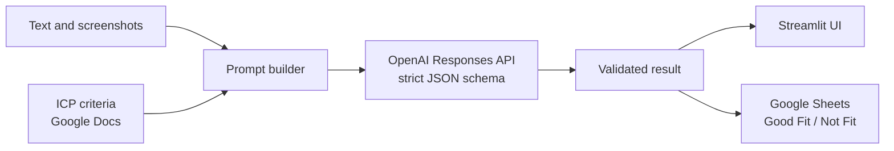

# LeadGen AI Agent

**An LLM-powered assistant that qualifies B2B leads in seconds instead of minutes.**

Paste a job posting or company profile (or drop in a screenshot), pick an Ideal Customer Profile, and the agent extracts the company details, decides whether it is a good fit, explains why, and saves the result to Google Sheets.


## Why I built it

I work as an SDR and qualify companies by hand: open the vacancy, check the company size, tech stack and location, compare everything with the ICP, then copy the data into a spreadsheet. It took about **5 minutes per company**.

I built this tool for my own daily work. It now takes about **40 seconds per company**, and I use it on **~200 companies a week**.

## What it does

- **Qualifies against configurable ICPs.** Criteria live in Google Docs, so they can be edited without touching code. Three profiles are included: .NET, Angular and React hiring.
- **Understands text and screenshots.** Job descriptions, LinkedIn pages and company websites can be combined in one request.
- **Returns structured data.** Company name, website, LinkedIn URL, size, job title, an ICP verdict (`Yes` / `No` / `Unknown`) and a one-sentence reason.
- **Saves results automatically.** Each lead goes to the matching Google Sheet, in the `Good Fit` or `Not Fit` tab.
- **Shows the cost.** Input, output, cached and total tokens are displayed after every analysis.

## How it works



## Key technical decisions

| Problem | Solution |
| --- | --- |
| LLM answers in free-form text are hard to store reliably | **Structured outputs** with a strict JSON schema (`strict: true`, enum for the verdict, `null` for missing fields) |
| The model may invent missing data | The prompt allows only facts supported by the input and requires `null` otherwise |
| Screenshots are expensive in tokens | **Image preprocessing** with Pillow: EXIF rotation, edge-density detection to crop empty side margins, resizing to 1600 px, JPEG compression |
| The same ICP text is sent with every request | **Prompt caching** with a per-ICP `prompt_cache_key`, so repeated criteria are billed as cached tokens |
| Responses can be cut off by the token limit | Explicit handling of `incomplete_details` and invalid JSON, with a clear message to the user |
| Criteria change often | ICPs are loaded from Google Docs and cached for 10 minutes; profiles are added in `config/icps/catalog.json` |

## Tech stack

Python · Streamlit · OpenAI Responses API (`gpt-5-mini` by default) · Pillow · Google Docs API · gspread · Google service-account auth · python-dotenv

## Project structure

```text
LeadGen-AI-Agent/
├── app.py                     # Streamlit UI, image preprocessing, LLM call and JSON schema
├── services/
│   ├── google_docs.py         # Reads ICP criteria from Google Docs
│   └── google_sheets.py       # Routes and appends results to Google Sheets
├── config/
│   └── icps/catalog.json      # ICP profiles: Google Doc and Sheet IDs
└── requirements.txt
```

## Run it locally

```bash
git clone https://github.com/irenezvirkovska-hue/LeadGen-AI-Agent.git
cd LeadGen-AI-Agent
python -m venv .venv
source .venv/bin/activate        # Windows: .venv\Scripts\activate
pip install -r requirements.txt
```

1. **OpenAI.** Create a `.env` file:

   ```dotenv
   OPENAI_API_KEY=your_openai_api_key
   OPENAI_MODEL=gpt-5-mini
   ```

2. **Google.** Enable the Google Docs, Sheets and Drive APIs, create a service account and save its key as `config/credentials/google-service-account.json` (or put it in Streamlit secrets as `google_service_account`). Share each ICP document with the service account as a viewer and each results spreadsheet as an editor. Every spreadsheet needs `Good Fit` and `Not Fit` tabs.

3. **ICP profiles.** Replace the document and spreadsheet IDs in `config/icps/catalog.json` with your own.

4. **Start the app:**

   ```bash
   streamlit run app.py
   ```

Credentials (`.env`, `config/credentials/*.json`, `.streamlit/secrets.toml`) are excluded from Git.

## Limitations

The agent evaluates only the evidence you give it: it does not browse websites or scrape LinkedIn. The final decision on a lead stays with a person.

## Roadmap

- [ ] Evaluation set: compare the agent's verdicts with 50 manually labelled companies and report accuracy
- [ ] Unit tests for image preprocessing and result routing
- [ ] Demo mode that runs without Google credentials

---

Built by **Iryna Zvirkovska**: [GitHub](https://github.com/irenezvirkovska-hue) · [LinkedIn](https://www.linkedin.com/in/iryna-zvirkovska/)
